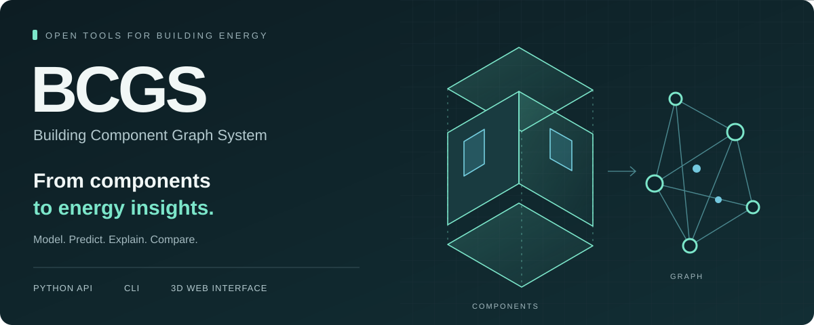
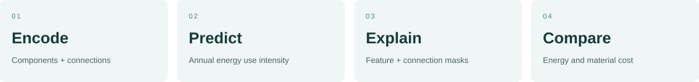
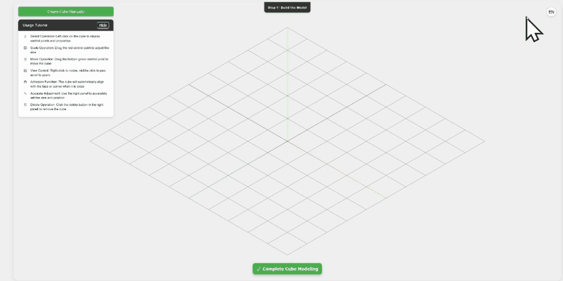
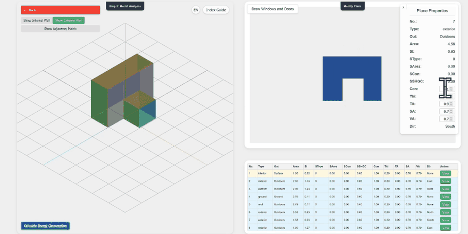
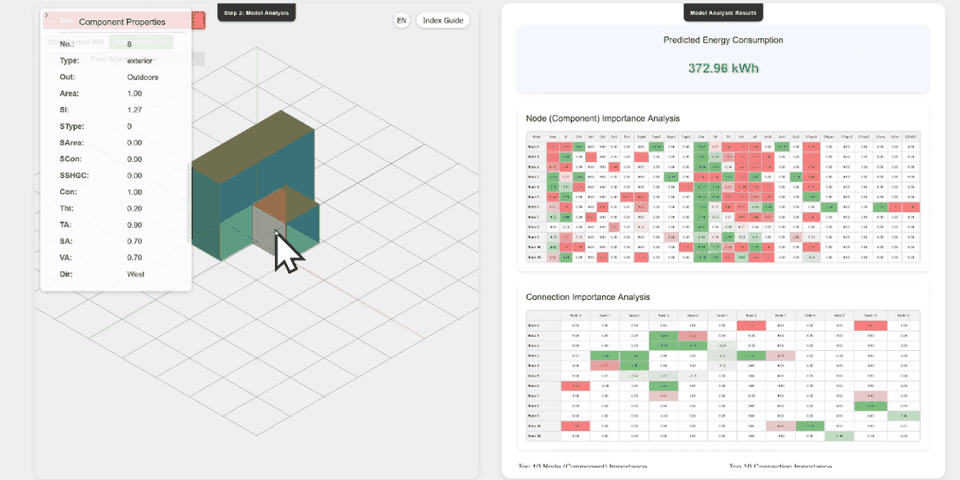
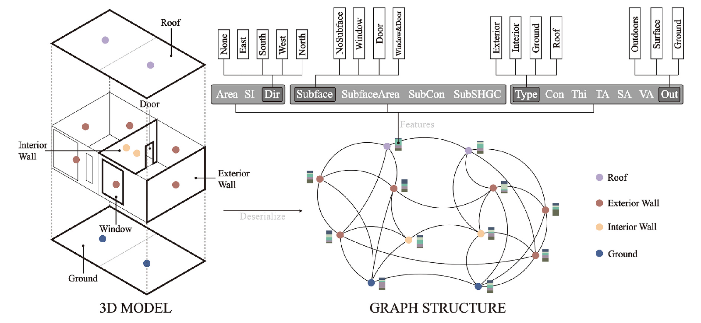

<p align="center">
  
</p>

<p align="center">
  <a href="https://bcgs.vercel.app/"></a>
  <a href="#install-and-run"></a>
  <a href="docs/usage.md"></a>
  <a href="#papers-and-citation"></a>
</p>

<p align="center"><b>Python 3.10+ &nbsp; · &nbsp; CPU inference &nbsp; · &nbsp; Included model &amp; example</b><br>
<a href="LICENSE"><b>Non-commercial research only · No commercial use</b></a><br>
<a href="README.zh-CN.md">中文说明</a> &nbsp; / &nbsp; <a href="docs/data-format.md">Input format</a> &nbsp; / &nbsp; <a href="web/README.md">Run the web app locally</a></p>

## Building energy, component by component

**Turn building components into graphs, predict energy use, explain predictions, and compare material options.**

BCGS brings the original Enhanced GAT model into a small Python toolkit, with a CLI and an optional Vue / Three.js interface. A building example and material tables are included. Try the example on CPU without Rhino, Grasshopper, or EnergyPlus.



## See the workflow

### 01 · Build in 3D

Create and resize volumes, position rooms, and assemble a connected building.

<a href="web/frontend/public/videos/page1.mp4"></a>

<table>
<tr>
<td width="50%"><b>02 · Inspect the components</b><br>Set wall and opening properties; inspect the graph inputs.</td>
<td width="50%"><b>03 · Explore the prediction</b><br>Inspect component features and connections in the analysis view.</td>
</tr>
<tr>
<td><a href="web/frontend/public/videos/page2.mp4"></a></td>
<td><a href="web/frontend/public/videos/page3.mp4"></a></td>
</tr>
<tr>
<td><a href="web/frontend/public/videos/page2.mp4">Watch full component walkthrough →</a></td>
<td><a href="web/frontend/public/videos/page3.mp4">Watch full analysis walkthrough →</a></td>
</tr>
</table>

<sub>Recordings show the original web workflow, shortened and played at 2× speed. They illustrate interaction, not the output of the packaged sample. The toolkit now uses standard explanation masks; numerical results and optimization behavior can differ from these recordings. See <a href="docs/migration.md">migration notes</a>. <a href="docs/assets/README.md">Still images &amp; media sources</a>.</sub>

**Choose your entry point:** [existing online demo ↗](https://bcgs.vercel.app/) · [local web setup](web/README.md) · [Python / CLI quick start ↓](#install-and-run). The hosted demo is an existing deployment; its API availability and version may differ from your local checkout.

## Install and run

Python 3.10 or newer. Install PyTorch for your machine first; this CPU setup is sufficient:

```bash
git clone https://github.com/YantingShen-dev/BuildingComponentGraphSystem.git
cd BuildingComponentGraphSystem
python -m venv .venv
```

Activate the environment:

```bash
# Windows PowerShell
.\.venv\Scripts\Activate.ps1

# macOS / Linux
source .venv/bin/activate
```

```bash
python -m pip install torch --index-url https://download.pytorch.org/whl/cpu
python -m pip install .
bcgs demo
```

The included example has **19 components, 102 undirected connections, and 26 encoded features**. Its reference prediction is approximately **508.0457** in the checkpoint's annual EUI target units, kWh/(m²·year). This is a reproducibility check, not a measured energy benchmark. See the [model notes](docs/models.md) before applying the checkpoint to a new project.

## Use your own building

### A building is an attributed graph

Walls, roof and ground become nodes. Their connections become edges. Geometry, materials and openings become node attributes.



<sub>Figure 3 from Shen et al., <i>Energy &amp; Buildings</i> 349 (2025), 116584. <a href="https://doi.org/10.1016/j.enbuild.2025.116584">Read the core method ↗</a></sub>

### Bring your data

Export the example and replace its component rows and adjacency matrix:

```bash
bcgs demo --export-input my-building.json
bcgs validate my-building.json
bcgs predict my-building.json --output prediction.json
bcgs explain my-building.json --epochs 100 --output explanation.json
```

You can also pass a directory containing headerless `node.xlsx` and `adjmatrix.xlsx`. Energy simulation labels are not needed for inference. The [data format](docs/data-format.md) specifies column order, category values, and units.

```python
from bcgs import BuildingGraph, EnergyPredictor, load_example

building = load_example()  # Or BuildingGraph.from_json("my-building.json")
predictor = EnergyPredictor()

print(predictor.predict(building))
explanation = predictor.explain(building, epochs=100)
```

## Compare materials

```bash
python -m pip install ".[optimize]"
bcgs optimize examples/building.json --population-size 20 --generations 5 --output options.json
```

Results contain nondominated energy–cost candidates and their complete graph inputs. The supplied prices are illustrative; use your own tables for project-specific comparisons. [Optimization assumptions and Python example →](docs/usage.md#material-optimization)

## Optional web interface

The existing interface supports building modeling, graph inspection, prediction, explanation, and material comparison.

```bash
python -m pip install ".[web]"
bcgs serve
```

In a second terminal, with Node.js 20+:

```bash
cd web/frontend
npm ci
npm run dev
```

Open `http://localhost:5173`. Both prediction and optimization use the same API on port 5000. [Configuration and deployment →](web/README.md)

## Package contents

```text
src/bcgs/       Graph encoding, GAT inference, explanations, optimization, CLI/API
examples/       Small building input and Python walkthrough
docs/           Input contract, usage, model notes, migration notes
web/            Optional Vue interface and API entry point
tests/          Prediction regression, input validation, explanation, optimization, API
```

Only the **building-level ENB checkpoint** is included. Multi-scale CAADRIA models and the AEI / UFUG workflows are related research, not installed features of this release.

## Papers and citation

| Publication / role | Paper | Open |
|---|---|---|
| **Energy & Buildings**<br>Core BCGS method | Building energy modeling with replaceable components using graph attention networks | **[Read&nbsp;↗](https://doi.org/10.1016/j.enbuild.2025.116584)** |
| **CAADRIA 2026**<br>Multi-scale extension | Multi-Scale Graph Embedding and Explainability Consistency for Building Energy Modeling | **[#56&nbsp;↗](https://www.caadria2026.org/paper-session)** |
| **Advanced Engineering Informatics**<br>Related visual representation method | Decoupling visual semantics via explicit representation learning for urban building energy modeling | **[Read&nbsp;↗](https://doi.org/10.1016/j.aei.2026.105335)** |
| **Urban Forestry & Urban Greening**<br>Related urban morphology application | Revealing nonlinear impact disparities of vegetation-building configurations on carbon sequestration efficiency through representation learning | **[Read&nbsp;↗](https://doi.org/10.1016/j.ufug.2026.129292)** |

The CAADRIA link opens the official conference paper listing (entry #56).

<details>
<summary><b>Cite the included model · BibTeX</b></summary>

For use of the included model, cite the ENB paper:

```bibtex
@article{shen2025bcgs,
  title = {Building energy modeling with replaceable components using graph attention networks},
  author = {Shen, Yanting and Zhu, Junlin and Zhang, Qibo and Huang, Chenyu and Ye, Jiahong and Yao, Jiawei},
  journal = {Energy and Buildings},
  volume = {349},
  pages = {116584},
  year = {2025},
  doi = {10.1016/j.enbuild.2025.116584}
}
```

</details>

## License

**Non-commercial research is permitted. Commercial use is prohibited.**

This version is distributed under the custom [BCGS Non-Commercial Research License](LICENSE). You may study, run, modify, and share the project for non-commercial research under its terms. Commercial products, paid services, commercial project work, and business-oriented R&D are not permitted. Redistributed copies and modifications must retain the license and attribution. Cite the relevant paper when publishing research using BCGS.

This is source-available research software, not an OSI-approved open-source license. Third-party dependencies and published paper figures retain their own terms. The change does not revoke rights already granted under MIT for earlier releases. [中文授权说明](docs/licensing.zh-CN.md)

[Research-use license](LICENSE) · [Citation metadata](CITATION.cff) · [Report an issue](https://github.com/YantingShen-dev/BuildingComponentGraphSystem/issues)
