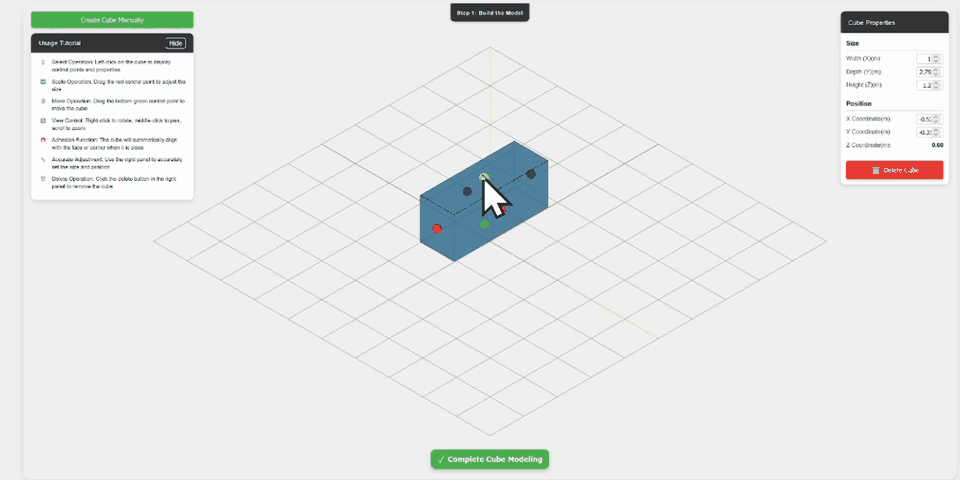
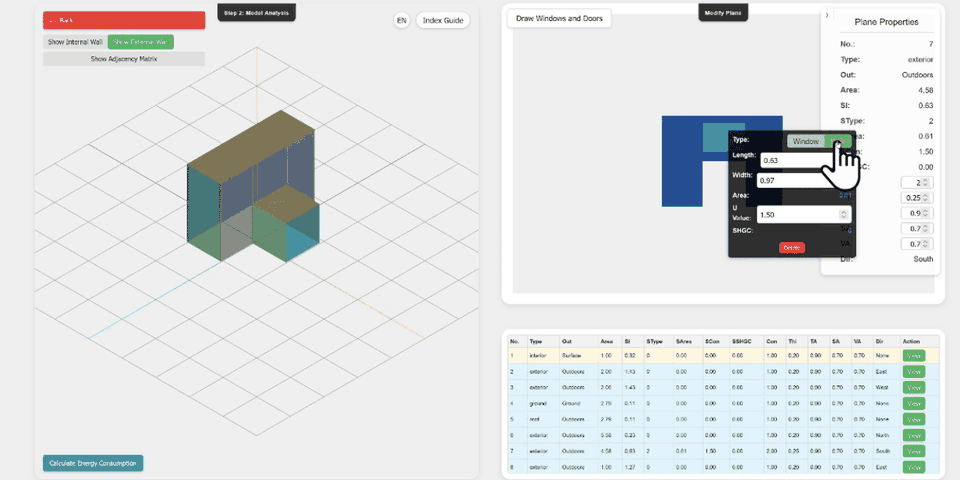
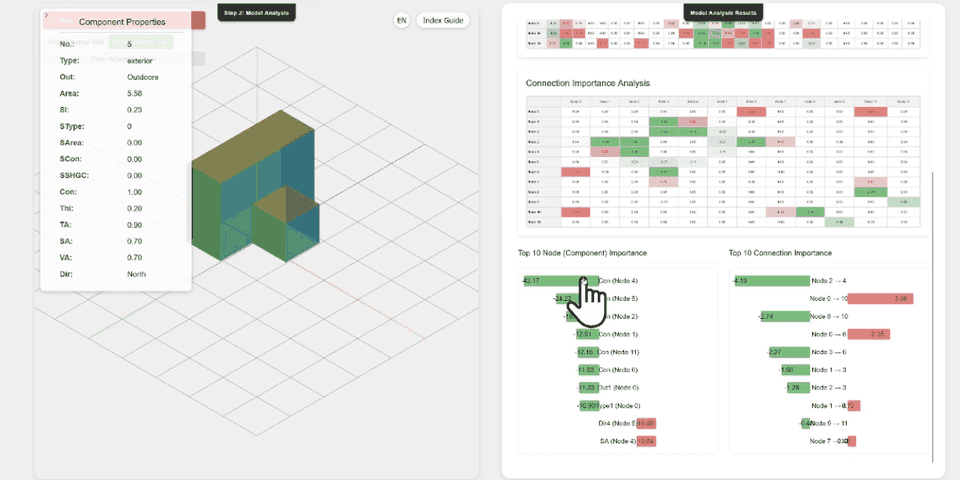

# Documentation media

These assets explain how to use BCGS. They do not report new evaluation results.

| Asset | Source and preparation |
|---|---|
| `hero.svg`, `workflow.svg`, `button-*.svg` | Original vector artwork for this repository. The building and graph in the cover are illustrative. MIT, as repository-authored artwork. |
| `modeling.gif` | Original BCGS `page1.gif`, seconds 8–44; 960 × 480, sampled every 0.4 s, played at 2× speed. |
| `components.gif` | Original BCGS `page2.gif`, seconds 26–66, same preparation. |
| `explanations.gif` | Original BCGS `page3.gif`, seconds 6–46, same preparation. |
| `*-still.png` | A middle frame from the corresponding animation, for a non-animated alternative. |
| `component-graph.png` | Figure 3, cropped from page 5 of Shen et al., *Building energy modeling with replaceable components using graph attention networks*, Energy & Buildings 349 (2025), 116584. [Published article](https://doi.org/10.1016/j.enbuild.2025.116584). Original figure content is unchanged; attribution is retained in both READMEs. The paper figure retains its original publication rights and is not relicensed by the code's MIT license. |

The recordings come from the project's original web release. Full walkthroughs
are in [`web/frontend/public/videos`](../../web/frontend/public/videos).
They show interaction, not current package outputs. In particular, the package
uses standard explanation masks rather than the original perturbation display;
see [migration notes](../migration.md).

## Static alternatives

### Modeling

### Component editing

### Original analysis view

